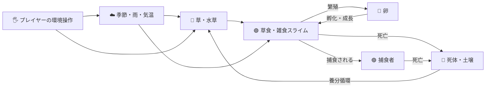

# Edenomaly — 予想外の進化を観察する人工生命ゲーム

> **Paradise Never Evolves as Planned.**  
> 楽園は、思いどおりには進化しない。

Edenomaly = **Eden（楽園）** + **Anomaly（想定外の現象）**。

プレイヤーがスライムを直接操作するのではなく、**地形・気候・資源を変えると、個体が何をし、何が生き残るのか**を観察するブラウザ向け人工生命シミュレーションです。進化や種の定着はあらかじめ決めた結末ではありません。

**現在の実装版：`2026.11.28.9`**（画面上部にも実行版を表示）

## ゲームでできること

| 🔭 観察する | 🌎 環境を変える | 🧬 発見する |
|---|---|---|
| 採食・交配・産卵・孵化・争い・捕食・休眠・死亡 | 草地・森・池・深水域・乾燥地・岩山・気温・雨・植物の再生 | 新種・希少な繁殖方式・しっぽ・角・触角・体表模様・変わった生存戦略 |
| 図鑑・イベント履歴・資源推移・繁殖診断 | 草や水草の補充・土壌改良・干ばつ・降雨 | **種族ごとの全数値能力の最小・中央値・最大をゲーム内で比較** |



*上図はゲームの関係性を示した概念図です。すべての生態的関係が常に成立するわけではありません。*

## 移入画面の左右パラメータビュー（2026-11-23.7）

移入用パラメータ調整画面を**左右二列の一画面表示**に変更しました。左には **基本ステータス6項目、スキル6項目、生存戦略7項目** をすべて展開した状態で表示し、右には **37の応用パラメータ（生態・環境11／繁殖・子育て9／行動・感覚6／体型・模様11）** を表示します。

左で数値やスキルを変更すると、右の派生値、増減の矢印、外観プレビュー、種族名、ポイント残高が即時に更新されます。右の値は**読み取り専用**であり、別の遺伝子ではありません。各項目にカーソルを合わせると算出式を確認できます。さらに「📐 変換式の詳細」から全37項目の一覧表を開けます。

PCでは幅広のダイアログと小型カードで原則一画面に収めます。画面の高さが足りない場合は各列内部でスクロールでき、スマートフォンなど幅が狭い画面では縦配置に切り替えます。

## 休眠・卵中の自動早送り、生態系構築、長寿個体戦略（2026-11-28.1）

- 活動中の生命が1体もおらず、生存個体が全員休眠または孵化可能な卵のみが残った状態で自動2倍速。1体でも活動・孵化すると元の設定速度に戻る。全滅では倍速なし。
- 新スキル「種まき」は採食で貯めた種子と本人のエネルギー・水分を使って近くの餌場を増やす。新スキル「水場造成」は雨天・湿地等の高い土壌水分と十分な体力があると小さな池を掘る。いずれも連鎖遺伝し、無制限に食料・水が生まれることを防ぐ制約あり。
- 新地形「湿地」「火山地」はマップに自動配置。土壌水分・植物生産性・高低温・移動と生存の負荷・描画をそれぞれ異ならせ、ゲームの地形編集にも対応。
- 生存期間300ステップを超えた親ほど子の突然変異確率が40%から最大79%まで上昇。変異は有利とも不利とも限らず、新種の強制出現はない。ゲームで9ptの「長寿個体支援」を選ぶと特定の成熟個体を給餌・給水・軽度の防疫で守れる。効果は一時的で不死身にはならない。

## 荒野モードと自動介入（2026.11.28.9）

- **🏜 荒野モード**：ゲーム開始ダイアログの「荒野モードで開始」から選択。通常の地形をほぼ乾燥地に置き換え、マップ中央に**草地3マス・接続した水域3マス**だけを設ける。草地には植物、水場には水草がある。初期介入ポイントは荒野モードのみ300pt（通常モード15pt）。新しい世界の開始・リトライで通常モードへ戻る。
- **🌱 自動種まき機（240pt）**：クリック地点の半径3マス内へ20ステップごとに、計600ステップ種まき。荒野では隣接する草地から乾燥地への草地拡大も起こり得る。乾燥条件が厳しい場所では作用しない。
- **💧 自動給水機（220pt）**：同じ範囲・期間・周期で土壌水分と池の水量を補充。自動種まき機と組み合わせることで乾燥地を開拓しやすくなる。
- **生命による土地づくり**：既存の遺伝スキル「種まき」は、荒野では条件を満たす乾燥地を草地へ変換できる。既存の「水場造成」は湿った岸辺を掘って水場を形成する。死骸に含まれる種は草地を作り、荒野で一定以上の質量を持つスライムの死骸は、分解の過程で十分な水分が確保できると池へ変化することがある。
- **ゲーム性**：種まき・池づくりは条件を満たす必要があり、自動機械も600ステップで停止する。介入は無限に無料で資源を増やさず、既存の感染・餓死・捕食・気候などの生態ルールを引き継ぐ。ゲーム難易度と長期定着率の実測検証は未完了。
- 介入の発動波紋と期間中の範囲表示は既存エフェクト機構を再利用する。

## 介入エフェクト・持続範囲の可視化（2026.11.28.8）

- ゲームモードで実行した**全介入**（地形1マス変更、種まき、土壌改良、防疫、長寿個体支援、広域植生再生、湖沼造成、大地改造、降雨、保護区、給水拠点、突然変異の波、進化の聖域など）に、実行地点を中心とした色別の短い波紋を表示。失敗・ポイント不足時は表示しない。
- **持続時間がある介入**は、効果期間中にエリアを淡く着色し、範囲境界を脈動させる。突然変異の波（400ステップ）は**全マップ**に紫色の薄いオーバーレイ、進化の聖域（600ステップ）は指定地点の半径115ワールド単位に金・紫の円、保護区・給水拠点もそれぞれ効果範囲を表示。降雨、防疫、長寿個体支援もそれぞれの有効期間中に視覚表示。
- 介入エフェクトは**生態シミュレーションや乱数を変更しない描画専用処理**。戦闘エフェクトを非表示にしても介入演出は確認でき、低負荷モードでは輪の描画を簡略化する。リセット時に持続演出を消去し、終了時間を過ぎた演出は表示しない。
- `web/intervention-visuals.js` に演出定義と描画を分離。`web/game-experience.test.mjs` に全操作の演出定義や終了・リセットの回帰テストを追加。**実機での表示・テスト実行は別途確認が必要**。

## 体表スキル表示の見直し（2026.11.28.7）

スライムの体表に表示していた「牙・眠・育・分・芽・水・再・巣」の漢字を廃止し、色と丸・楕円・三角・四角の小さな模様に変更しました。水棲・繁殖方式を表していた「水・双・単」も文字を使わない記号に変更。スキルの効果、種族判定、遺伝ルールは変更していません。

## 最新版の遊び方：希少進化と大規模介入（2026.11.28.5）

ゲームモードでは、レアな進化を発見して介入ポイントを獲得し、地形や生態系に大きな変化を起こせます。**観察・発見 → 報酬 → 環境への介入 → 新たな進化の観察**が中心の遊び方です。プレイヤーが望む新種を直接生成する機能ではありません。

### レア進化・イベントの報酬

| 達成条件 | 介入ポイント | 判定 |
| --- | ---: | --- |
| 新種発見 | +20pt／種 | 新しく記録された種の数に応じて付与 |
| しっぽを持つ種を初発見 | +100pt | 進化段階1を初達成 |
| 足を持つ種を初発見 | +200pt | 進化段階2を初達成 |
| 手を持つ種を初発見 | +400pt | 進化段階3を初達成 |
| 天使の羽の完全形を初発見 | +800pt | 進化段階4を初達成 |
| 悪魔の羽の完全形を初発見 | +800pt | 進化段階5を初達成 |
| 羽まで揃った完全形を初発見 | **+3,000pt** | 段階4または5を初達成 |
| 長寿個体（1500ステップ） | +35pt | 生存中の個体で判定 |
| 3種／5種の同時共存 | +30pt／+65pt | 生存個体の種数で判定 |
| 生命による種まき／水場造成 | +25pt／+60pt | 実際の成功イベントで判定 |
| 天使・悪魔の羽を両方発見 | +120pt | 両系統の登録で判定 |

これらの達成報酬は**同じゲーム試行内では各条件につき1回だけ**です。新種の発見報酬と希少形態報酬は条件を満たすと加算されます。別のゲーム試行では達成状況がリセットされます。従来の生存・定着・世代更新による介入ポイントも継続します。

### 介入操作とコスト

| 操作 | 消費pt | 効果・制約 |
| --- | ---: | --- |
| 🌱 草・水草の種まき | 5 | 周辺の餌資源を補充 |
| 🌿 土壌改良 | 10 | 指定地点の土壌を改善 |
| 🩺 防疫・治療 | 9 | 周辺の感染個体を治療 |
| 🪺 繁殖保護区 | 7 | 卵を260ステップ保護 |
| 💧 給水拠点 | 6 | 周辺へ給水、200ステップ持続 |
| 🛡 長寿個体支援 | 9 | 300ステップ以上生きた成体へ給餌・給水・防疫 |
| 🌲 広域植生再生 | 40 | 半径5マス程度の植生・水分・土壌を改善 |
| 🏞️ 広域保護区 | 50 | 500ステップ、卵・水分・感染への支援 |
| 🌊 湖沼造成 | 75 | 既存の水域に接続して池を拡張。生命・卵を巻き込まない |
| 🏔 **大地改造** | **1,000** | 半径4マス程度の草地・乾燥地を湿地化。生命・卵がいるセルは除外 |
| 🧬 **突然変異の波** | **2,000** | 世界全体で400ステップ、交配由来の突然変異確率を上乗せ（最大95%）。実行中の再発動は不可 |
| ✨ **進化の聖域** | **4,000** | 生存個体の近くに600ステップ持続する保護区を生成。卵・水分・感染対策を支援 |

上記以外に、降雨（8pt）と地形1マスの編集（地形により2〜7pt）があります。

ゲームモードで操作ボタンを選び、**マップ上の対象地点をクリック**して実行します。ポイント不足・対象条件を満たさない操作は発動せず、ポイントも消費しません。高額介入を含む実行履歴は `GameSession.interventionHistory` に記録します。

**ゲーム性上の制約：** 突然変異は有利・不利の両方があり、種の成立・定着は保証されません。進化の聖域も不死身化や必ず繁殖する効果ではありません。介入後100ステップの局所的な生態指標を既存UIで確認できますが、変化がすべて介入に起因するとは限りません。

**検証状況：** `web/game-experience.test.mjs` に報酬の重複防止・高額操作・状態初期化・ボタン存在のテストを追加しました。テストの実行結果およびブラウザでの実機確認は未検証です。

## 過去の更新履歴：希少イベントと広域介入（2026-11-28.4）

> この節は当時の変更履歴です。**現在のコスト・報酬・操作一覧は上の「最新版の遊び方」を優先**してください。


**レア事象を実際に発見したときだけ一度受け取れる介入ポイント**を追加。1500ステップ生きた個体（35pt）、3種共存（30pt）、5種共存（65pt）、生命による種まき初成功（25pt）、水場造成初成功（60pt）、天使・悪魔の羽を持つ両系統の発見（120pt）。既存の「羽付き完全形」初発見報酬等も維持。判定は生存個体・発見種・実際の環境操作カウンタに基づき、\`GameSession.milestones\` で重複払いを禁止。

**高額介入の3択**：🌲広域植生再生（40pt、半径5マスで草・水分・土壌を増強）、🏞️広域保護区（50pt、500ステップ間、卵の保護・水分・緩やかな感染対策）、🌊湖沼造成（75pt、既存の池に接続して複数マス拡張）。湖沼造成は既存水系に隣接する草地・湿地だけ対象にし、個体・卵のいるマスは水に変えない。自然繁殖を飛ばして水草を無償生産しない。

各操作はゲームモードの操作ボタンから選び、マップの場所をクリックして使用。予算不足・適切な場所がない場合は実行・課金をしない。実施とその前後の生態影響は既存の介入ログに保存される。いずれも本格的な世界への介入だが、不死身化や新種の強制生成はしない。

## 過去の更新履歴：しっぽ→足→手→羽の希少進化（2026-11-28.3）

> 当時の進化報酬（3／7／15／60pt）は現在の報酬額ではありません。最新版の表を参照してください。


- 遺伝する能力から段階式に表現：しっぽ→丸い足（指なし）→丸い手（指なし）→背中の羽。上位の器官は下位の器官を持つ必要があり、最後の羽はきわめてまれ。
- **天使の羽**（白い羽根状）と**悪魔の羽**（紫の膜状）は捕食・反撃などの遺伝形質から分岐する。どちらも背中に付く。
- 体表の見た目を新種判定に反映。同じ見た目なら小さい能力差は同種、進化段階や羽のタイプが変われば別種となり、名前も必ず異なる。
- ゲームには「進化目標 0/4→4/4」を表示し、初めてその段階の種族を発見したときに介入ポイントを3、7、15、羽付き完全形は60付与する。繰り返し報酬や強制突然変異はなし。
- スライムの遺伝子操作では全特徴種が実現可能。生存と繁殖の選択圧はそのままで、見た目の達成だけで無敵にならない。

## 見た目に基づく種族定義（2026-11-28.2）

種族を生息地・微細な遺伝的適応からではなく、見た目の色分類・体格・形・目の数・目立つ付属器と8つの重要なスキルのマークで判定する。小さな能力差は同じ種のまま、新種判定では同じ見た目のスライムを細分化しない。捕食／休眠／親の給餌／分裂／種まき／水場造成／再生／巣作りは、個体の体表の専用の色と形の模様として表現し、スキルが異なる場合は種族分類も異なる。分類キーだけから一意のカタカナ5文字種族名を生成。色カテゴリを先頭文字に対応させ、系統的に近い名前を作る。細かな視覚的な違いがすべて種の違いになるわけではない。

## 拡大縮小後の地形描画不整合修正（2026-11-27.5）

マップを40×23から60×35に拡大した際、標準の地形描画は更新されたが、高品質地形オーバーレイ（`web/terrain-visuals.js`）だけ旧サイズ・旧40列のインデックスを使っていた。旧範囲のみ別地形として重ね描きし、右端・下端との間に不自然な描画境界が出ていた。`WORLD` の幅・列数・行数に統一し、右端・下端の描画と描画による乱数状態不変をテストする。古いJSがブラウザキャッシュに残らないようバージョンも更新。

## 全個体休眠中の自動2倍速（2026-11-27.4）

生存中の全個体（死亡済みは除く）が休眠状態のときに限り、シミュレーションの実行速度を一時的に2倍にする。「💤 全個体が休眠中のため自動早送り ×2」と速度ボタン横に表示。1体でも覚醒、または休眠していない新生個体が出現すると即座に通常のユーザー設定速度へ戻る。個体が0匹の場合と手動停止中は自動早送りせず、学習・季節・孵化・自然選択のシミュレーション規則は一切変えない。表示の再描画頻度は変えない。

## ワールド拡張とランダム初期種の多様化（2026-11-27.3）

- ワールドは **40×23（800×460）→ 60×35（1200×700）** に拡張。セル20ピクセルの解像度は維持し、面積は約2.28倍。水域・乾燥地・岩場を東部・南部に追加し、ズーム・観察・地形編集の有効範囲も拡張。
- ランダム開始では草地限定を廃止。草地／水域／乾燥地／岩場の中から生息域を確率的に決定し、食料が比較的豊富な地点を選択。その環境向けに適応させた複数の遺伝子候補から始祖を抽選。初期1種8体、介入ポイントと報酬ルールを維持。
- 世界の乱数Seedは開始・初期化のたびに変更（従来の修正を維持）。選ばれた環境と始祖分類の多様性を `web/world-expansion.test.mjs` で検証する。
- 地形参照やゲームの介入判定の「旧40列・23行」固定値を `WORLD.columns` 等へ置換した。高負荷を避けたい場合は省負荷モードが利用できる。

## 短く、分類と一致する種族名（2026-11-27.2）

**種族の同一性は `Ecosystem.category(g)` が返す分類キーで確定します。** 名前はそのキーだけを入力に決定的に付け、最初に発見された個体の遺伝子や微細な遺伝子署名は使いません。同種は必ず同名、異なる分類には絶対に同名が付きません。

- **通常4文字**：1文字の系統頭文字（生息域×食性の12系統）＋3文字の基本分類コード（体格、体型、目、戦略、繁殖方式、好適温度、体色の9072通りを重複なく表現）
- **外観分類付き6文字**：上記＋2文字で発見された色名×外見特徴の区別を符号化。ゲーム中の現行種族は主にこの6文字名を持ちます
- 先頭の1文字と最初の4文字を系統の目印として共有するため、同じ生息域・食性、または外見のみが違う種族には似た名前が付きます
- 表示名はカタカナ辞書と可逆的な混合基数計算によって自動生成。短い自然な響きの偶然の組み合わせも楽しめるようにし、命名に乱数は使いません
- 遺伝子コードや長い「色・ステータス・外見特徴」の連結は廃止。種族名ではなく図鑑のステータスや外見を見て違いを調べられます

テストは9基本分類要素の108,864通りと、外観分類の色×特徴の全組み合わせを対象に重複を検査。ゲームの進化シミュレーションの統計や分類ルールそのものは変更していません。

## 能力値とスキルで色が変わる遺伝的体色（2026-11-27.1）

生息域（草地・水域・乾燥地・岩場）を体色の基本色として維持しながら、基本6能力の組合せで色相を幅広く変える。ちから・すばやさ、かしこさ・はんしょく、てきおう・たいりょくの対比を色相に反映し、給餌・捕食・休眠・水草栽培スキルで軽い色調差を加える。能力値は彩度・明るさにも作用する。DNA2から決定的に色を導くため、色は遺伝し、同じDNAなら常に同じ色になる。白化遺伝子は従来どおり白を優先。図鑑・種族名・卵・ゲーム画面・能力プレビューの色は共通の `adaptationColor()` を利用し、表示と分類の不一致を防ぐ。

同一生息域でも複数の色名・色相が発生することを `web/color-genetics.test.mjs` で検査。生息域以外の能力による色変更は、機能形質に由来する副次的な視覚効果であり、新しい独立した外見遺伝子の追加ではない。

## ランダム開始の固定Seedと卵の長期休眠を修正（2026-11-26.3）

ランダム開始で毎回同じ種が出る原因：画面上で `new Ecosystem()` を固定Seed `971253` で生成し、`reset()` が毎回同じ `initialSeed` から再開していた。今回ブラウザ版の各新規ゲームリセット時に `freshGameSeed()` で新しい乱数Seedを採番し、地形・始祖遺伝子・発生する進化を変える。ヘッドレス実験では引き続き固定Seedで再現可能。

卵の長期休眠：`skillHibernate` 由来の休眠能力や厚い卵殻があり、気温が適温外のとき休眠する仕様。休眠中の成長加算が `.008/step` で実質停止していたため `.04/step` に緩和。休眠環境中の孵化は禁じ、暖かく戻れば孵化する。休眠中は卵黄を消耗し、餓死可能な自然選択を維持。

新種数は元種によって異なる：先祖の異なる対立遺伝子、繁殖率、食性、生息環境への適応、生存期間で新種発生機会が変わる。形質がカテゴリー境界を超えた時に初めて新種として登録される。今回判定基準の緩和や新種の強制発生はしていない。

GitHub Actionsで追加テストを含む18件成功。全体テスト461件中459件成功、2件失敗（既存の生息型変異・肉食化のテスト）。3 Seed 各3000ステップで累計発見種数7・5・8。ただしSeed72は絶滅しており、個体群の存続や多様化を保証しない。

## ゲームモード標準化・ランダム開始と新種発見頻度（2026-11-26.2）

起動時はゲームモードをデフォルト表示し、開始ダイアログに「🎲 ランダムですぐ開始（設定不要）」を追加。能力設定画面・フィールドクリックを省き、比較的食料・水源に恵まれた陸上地点をランダム選択。ゲーム本来の初期1種8体、介入pt、ログ記録、報酬を使用し、追加の餌や生命を生成しません。手動の能力選択・配置は従来通り可能です。

新種の発見機会を増やすため、有性生殖の子の突然変異発生率を32%→40%へ小幅変更。新種判定基準は維持。GitHub ActionsヘッドレスSeed 72/73/74の各3,000step比較では合計発見種数が修正前 1/4/3種から変更候補 7/5/6種となりました。Seed 72の絶滅は防いでおらず、新種発生を保証しません。

## 遺伝的変化が発生しない突然変異イベントの修正（2026-11-26.1）

突然変異処理 `mutate()` は、変異イベントが選択されても遺伝子座ごとの追加抽選で何も変更せずに終了することがありました。現在は候補の再抽選により、実際に対立遺伝子を変更できる確率を改善しています。新種分類の条件（外見、環境、行動、繁殖戦略など）は変更せず、隠れた劣性遺伝子も引き続き新種とは扱いません。遺伝的多様性の向上が実際の新種成立につながるかは生存・繁殖による自然選択次第です。

検証：`tests/speciation-evolution.test.mjs`（実際の対立遺伝子の変更と、新種登録が実個体の誕生に依存することを確認）。Seed 72, 73, 74 の3,000ステップ試行では修正候補で合計発見種数 2, 4, 5（修正前 2, 3, 2）。3試行だけのため発生頻度全般を保証する結果ではありません。

## 飢餓耐性の実測修正（2026-11-25.5）

GitHub Actions のヘッドレス A/B 検証を繰り返しました。旧版に対して Seed 72/73/74 の3,000ステップ実験では、幼体が平均40ステップ前後で飢餓死する一方、死亡地点と同じタイルに植物がある個体はほとんどおらず、食料まで20〜50ワールド単位の距離が多いことが判明。`lifeDrain`を幼体0.25倍／成体0.55倍に抑え、HPが無くなるまでに採食へ到達する猶予を設けました。飢餓HP減少は継続し、餌不足で死ななくなるわけではありません。

不安定だった前回の遠方優先採食・空腹時のターゲット強制変更・幼体の移動速度調整は取り消し、元の採食処理に戻しています。獲得した巨大な体格の維持コストは過剰な3乗を修正した2乗モデルを維持しています。

3 Seed × 3,000ステップの試行結果（元版 2026.11.25.2 → 候補）：飢餓死 Seed72 334→206、Seed73 602→259、Seed74 347→269。生存数はSeed72 0→0（絶滅までのステップは1916→1951）、Seed73 34→75、Seed74 35→13。**飢餓死は減少しましたが、すべてのSeedで生存が改善するわけではありません。** 病気や捕食が相対的に強くなる影響も含め、今後の調整余地があります。

## ヘッドレス実測による飢餓診断（2026-11-25.4）

GitHub Actions (`.github/workflows/starvation-validation.yml`) で、表示OFFの`web/headless-cli.mjs`を同一Seedで旧版・新版比較。死亡原因「飢餓・栄養不足」の名称がログの「飢餓」と食い違い、headlessの飢餓集計がゼロになる不具合も修正しました。

`web/headless-runner.mjs` の結果には`starvationDiagnostics`（幼体・成体別、採食成功歴、周囲75ワールド単位にある通過可能な地形上の食料推定量）、`finalFood`を出力します。周囲の食料量は経路探索まで保証しない推定値であり、そのまま実際の採食可能量とは一致しません。

実測では幼体の飢餓死が多く、近辺に食料が残っていても採食できなかった個体が確認されたため、衰弱した幼体の移動能力と警戒判断を試験しましたが、Seedによって改善が安定しなかったため2026-11-25.5で取り消しました。現実の捕食者からの逃走は優先されます。

## 飢餓死・餌探索の修正（2026-11-25.3）

12件のゲーム終了ログ（旧2026.11.21〜11.23）を分析。総死亡1,543体のうち飢餓1,435体。特に4,494ステップの試行で、全1,123体中1,080体が飢餓死し、マップ全域では食料33,205が残りました。食料総量と局所到達可能性は異なるため、全域にあるだけでは個体の生存を保証しません。

修正：空腹時（エネルギー90未満）は採食範囲を広げ、残量の乏しい餌より栄養のある餌場を優先。エネルギー85未満では任意の交配・社会行動・移住より餌への移動を優先（捕食者からの逃走・重大な脱水は例外）。獲得サイズの代謝コストを過度な三乗増加から二乗増加に変更し、最大採食量より必要摂取量が極端に高くなるバランスを緩和。餌生成や自然回復の量は増やしていません。

検証：実装はmainに反映。旧ゲームログの解析は完了していますが、変更後の長時間実ゲームでの改善効果測定は未実施です。

## 新種発見時に「何が変わったか」を説明（2026-11-25.2）

新種の判定は基本6ステータスだけではなく、生息環境・食性・体格・体形・目の配置・行動戦略・繁殖方式・温度適性・色系統・体色・外見特徴の分類キーで行います。したがって、基本6値がすべて同じでも、行動・外見・戦略の分類が変われば新種と判定されます。

詳細新種発見ダイアログを改良し、最初に**「なぜ新種になった？」**を表示。分類上の差を親1・親2それぞれと比較します。次に**「遺伝子・スキル・生存戦略の変化」**で発現した値が変わった遺伝子を表示します。折りたたみの**「発現せずに変化した対立遺伝子」**と**「全27遺伝子の比較」**で隠れた保因情報も確認できます。従来の基本6値の比較も残しています。分類の違いと遺伝子差は別であり、隠れた対立遺伝子のみの変更では新種と判定されません。

回帰テスト：`tests/discovery-comparison.test.mjs`。実行例：`node --experimental-default-type=module --test tests/discovery-comparison.test.mjs`。

## 遺伝子連鎖と家系図の潜在遺伝子（2026-11-25.1）

- 27遺伝子座を**5本の染色体連鎖群**に固定配置（`web/linkage-model.js` の `LINKAGE_GROUPS`）。2つの相同染色体コピーを各親が持ち、減数分裂で各親から子へ1組ずつ伝わります。
- 染色体の隣接遺伝子座間で**8%の交叉確率**を設け、交叉が起きない範囲は一緒に継承されます。これはゲーム用の固定連鎖モデルで、現実の染色体数や遺伝子距離を表しません。
- 両親の配偶子から子の各遺伝子座を合成し、従来の優性・劣性・中間発現、片方の対立遺伝子に対する突然変異を維持。異なる生存戦略への突然変異も対立遺伝子として扱います。
- **🌳 家系図**：種ごとの発見時代表個体について、未発現の劣性遺伝子を金色で表示。各ノードのツールチップから染色体番号、全27遺伝子座の2コピーと発現値を確認できます。保因表示は0/1の劣性遺伝子座でのみ行います。
- 注意：家系図は個体の全親子関係ではなく「新種を初めて発見した時の代表ゲノム」です。既存個体のDNAが後から変更されるわけではありません。過去の試行ログは旧モデルのままです。

## 遺伝モデル：優性・劣性と隔世遺伝（2026-11-24.1）

Edenomalyは **27遺伝子座 × 2コピーの対立遺伝子** を内部に保持します。子は両親の各遺伝子座から1コピーずつ無作為に受け取り、突然変異は原則としてどちらかのコピー1つに起こります。両コピーは、外見や能力に発現しなくても子孫へ伝わります。

- **中間・加算遺伝：** 基本能力6種、食性・好適気温・群れ志向などは2コピーの平均を利用します。整数能力は1〜10へ丸めます。
- **優性（1コピーで発現）：** 瞬発ダッシュ、反撃、捕食、協力、親の給餌、水草栽培、産卵地選択など。
- **劣性（2コピー揃って発現）：** 休眠、幼体共食い、奇襲、自己再生、巣作り、吸収、分裂、および白化（albino）。
- **その他：** 水生（aquatic）は優性、繁殖方式（repro）は大きい値が優先、主適応地形（biome）は中間型です。これは現実の遺伝の厳密な再現ではなくゲーム上の仮説です。
- **隔世遺伝：** 劣性の保因者（遺伝子1/0）はスキル非発現でもコピー1を持っています。保因者同士の子で1/1になればスキルが発現します。単純な1遺伝子座なら1/1は理論上25%です。

移入時の「📐 変換式の詳細」に全27遺伝子の発現規則も表示します。発現ルールは `web/genome-model.js` の `INHERITANCE_RULES` と `expressAllelePair()` を単一の実装とし、交配・突然変異は `web/simulation.js` からそれを使用します。

これは **遺伝的アルゴリズムの交叉・突然変異・環境による自然選択** と、**生物学の二倍体・対立遺伝子・優性／劣性** を組み合わせた簡略モデルです。染色体上の連鎖と簡易交叉は2026-11-25.1で追加しました。実際の減数分裂の全過程、DNA塩基配列、遺伝子発現調節は再現していません。

## 進化家系図・スキル拡張（2026-11-23.8）

**種の図鑑 →「🌳 家系図」** を開くと、すべての発見種を「発見時のスライム画像＋名前」のノードとして表示します。親から新種へ向かう線が進化の枝を示します。二親が別種のときは両親から線が伸びます。絶滅した種も記録が残っていれば表示します。スクロールと拡大操作が可能で、**SVG・PNGで家系図を出力**できます。

家系図は発見時に保存された種の代表遺伝子と親スナップショットを使います。異なる種の間に進化の関係があっても、親が子と同じ種に分類される場合は自分自身への矢印を引きません。一般的な生物学上の系統樹とは異なり、**ゲーム内で観測した種の派生履歴**を表します。

スキルは**14種類**になりました。従来の水草栽培（栽培）・親の給餌（給餌）・産卵地選択・反撃・幼体共食い・休眠・瞬発ダッシュ・奇襲・自己再生に加え、捕食・巣作り・協力・吸収・分裂を追加しました。各スキルは0/1で遺伝し、実際の行動を起こすには体力・環境・相手などの条件が必要です。

| スキル | ゲーム内効果・制約 |
| --- | --- |
| **捕食** | 肉食時の攻撃と獲物から得る栄養を増強 |
| **巣作り** | 親のエネルギーを使い卵に保護を与える |
| **協力** | 近くの同系統の飢えた仲間へ余剰栄養を渡す |
| **吸収** | 肉食でなくても死体の残り栄養を吸収する。資源消費あり |
| **分裂** | 成体が栄養・水分・体力を大量消費して子を作る。低密度・冷却期間の制限あり |
| **給餌** | 親の余力を使い空腹の幼体に給餌 |
| **栽培** | 水生個体が水草の種を使い、水草の少ない水場へ植え付け |

遺伝子は **基本6 + スキル14 + 生存戦略7 = 合計27項目**。応用パラメータ37項目は依然として遺伝しない派生値です。

## 遺伝子 v2：基本ステータス＋スキル＋生存戦略（2026-11-23.8）

**遺伝するのは合計27項目だけ**です。旧37種類の応用パラメータ（感染耐性、産卵数、顎、眼数、尾、角、体形、体色関連など）は独立した遺伝子ではなく、新しい遺伝子から毎回計算される表現型になりました。

| 遺伝情報 | 項目数 | 内容 |
| --- | ---: | --- |
| **基本ステータス** | 6 | ちから・すばやさ・たいりょく・かしこさ・てきおう・はんしょく（各1〜10） |
| **スキル保有** | 14 | 水草栽培・休眠・親の給餌・産卵地選択・反撃・幼体共食い・瞬発ダッシュ・奇襲・自己再生・捕食・巣作り・協力・吸収・分裂 |
| **生存戦略** | 7 | 食性・生息型・繁殖方式・主適応地形・好適気温・群れ志向・白化 |
| **合計** | **27** | **親から子へ対立遺伝子2コピーを交配・突然変異で継承** |

内部では `web/genome-model.js` の `dna` が唯一の遺伝的な基礎情報です。`alleles` に保存するのも上記27項目だけで、`expressDNA()` によって旧37応用値を決定的に再計算します。`simulation.js` は従来の応用値を使って生態計算を続行できるため、行動やレンダリングのために別の遺伝子を増やしません。外見の角・ひれ・翼・触手なども同じ派生値から生成されます。

移入画面ではまず**基本6値を直接編集**し、14種類のスキルは「習得／外す」で切り替えられます。「🧬 生存戦略7項目を調整」から食性・水生・繁殖方式などを変更できます。ゲームモードの24ポイント制限は継続し、テストモードでは自由です。

初期移入画面の「📐 27遺伝子から37応用パラメータへの変換式」には、全37項目の算出式を記載しました。ゲーム中の個体選択・図鑑・新種発見・種族ステータス表示は引き続き基本6値に統一しています。研究用ログには派生値も出力されます。

**移行上の注意：** 古い37遺伝子方式で作られた個体データはそのまま子孫の遺伝モデルとして使えません。新規ゲームでは19項目の遺伝子を生成し、過去の分析CSVは旧方式の履歴として扱います。バランスや生存戦略はこの新モデルで再評価が必要です。

## すぐに始める（Windows / VSCode）

**Windowsでの推奨起動方法：** リポジトリ直下の `start_game.bat` をダブルクリックするだけで、GitHub更新 → サーバー起動確認 → 標準ブラウザ表示を実行します。Git と Python 3（Windowsの `py` コマンド）が必要です。

- `git pull --ff-only` に失敗した場合、ゲームは起動せず、エラーを表示します。ローカル変更やブランチの衝突を勝手に解消しません。
- 同じランチャーで既に起動している場合は二重起動せず、ブラウザだけ開きます（既存サーバー稼働中のGit更新は行いません）。
- 8000番ポートを別アプリが使用している場合は、誤ったページを開かずエラーにします。
- **終了方法：** ランチャーの黒いウィンドウで `Ctrl+C` を押すか、ウィンドウを閉じます。ブラウザのタブを閉じるだけではサーバーは停止しません。
- 更新せずに起動するときは、リポジトリ直下で `py -3 tools/launch_game.py --no-pull` を実行します。ポート変更は `--port 8001` などです。
- この方法はWindows向けです。macOS/Linuxでは `python3 tools/launch_game.py` を利用できます。

従来の手動実行も可能です。

```powershell
git pull --ff-only
py -m http.server 8000 --bind 127.0.0.1 --directory web
```

ブラウザで **http://localhost:8000/** を開き、**「生命を移入」** を選んでフィールドをクリックしてください。

- **テストモード**：制限なく生態系を試す。地形や気候を変え、スライムの変化を観察。
- **ゲームモード**：最初の移入と介入ポイントに制約があり、生存時間・発見・生態系の状態をスコア化。**3世代・12体を達成した種族の定着ボーナス**も獲得できます。
- **▶ 再生／Ⅱ 停止、1ステップ、速度×1／×3／×8**：時間を操作。
- **拡大・パン**：ホイールで拡大／縮小。中ボタンをドラッグ、または「✋ 移動」ONで左ドラッグ。
- **地形ブラシ**：草地・水辺・乾燥地・岩場と、**レベル1〜5**を選択して描く。初期マップにも中心ほど高レベルの地形が分布します。
- **資源と気候**：草と水草は独立した回復速度スライダー。四季・気温・降雨も操作可能です。

> 静的ファイルを配信するPythonはサーバーとしてのみ動きます。ゲーム本体は **HTML / CSS / JavaScript** です。 `web/index.html` を直接ダブルクリックするとES Modulesがブロックされる場合があります。

## 🎮 ゲームモード：観察・発見・介入・再挑戦（2026-11-14）

プレイモードで「🎮 ゲームモード」を選択すると、**ゲーム開始の案内**が表示されます。開始地点をフィールドでクリックすると、最初の1種・8体を移入し、**自動的に2.8倍へ拡大**して観察を始めます。

- **📍 視野固定**：当初の群れが離れていっても、カメラは残ります。見逃した地域でも進化は進みます。
- **🎯 群れを追尾**：ボタンを押すと、最初の群れ（絶滅後は残った近隣の子孫側）へ自動的にカメラを移動します。自分でズーム・パンすると追尾を解除できます。
- **群れへ戻る**：一度他の場所を観察した後、元の群れの近くへ戻ります。
- **視野内／視野外の個体数**：実際のズームとパン範囲で集計。視野内のエネルギー不足個体数も表示。
- **🔔 観察・発見イベント**：新種の発見・定着・視野外への拡散・栄養不足・介入ポイント獲得を、通常の大量イベントログとは別に表示。通知に位置情報がある場合「現地を見る」で移動可能。
- **遠方の生命反応**は初めは解放されていません。恒久報酬で解放すると、視野外の新種が発生した方角と調査位置を知らせます。未訪問の新種名は通知文で明かしません。
- **ゲームオーバー**：全個体と全卵の消失で自動停止。スコア・発見種・定着種・主な死亡原因・恒久報酬を表示。「次の世界へ」で再挑戦できます。

### 報酬を獲得・利用する

ゲーム中の行動で得る**介入ポイント**と、ゲーム終了時に蓄積する**恒久報酬ポイント**は別です。

| 解放内容 | 恒久報酬コスト | 効果 |
|---|---:|---|
| 🔭 遠方の生命反応 | 3pt | 離れた場所での新種・定着の兆候を重要イベントに追加 |
| 🌱 初期支援ポイント＋5 | 4pt | 次の試行の初期介入ポイントを15→20へ増量 |

恒久報酬はスコア1,000点ごとに1pt（切り捨て）獲得します。ゲーム開始の案内、またはゲームモードの報酬欄から解放できます。**どちらも1回購入するとブラウザに保存**され、次の試行から利用可能です。課金はありません。終了時の恒久報酬は同じ試行で二重に取得できないようにしています。

スライムの遺伝子や生態系の進化を直接操作する強化ではなく、まずは観察能力と介入の選択肢を増やす仕組みです。

**実験とテスト**：ゲームUIのイベント検出・視野計算・報酬解放・一度きりの報酬付与を `web/game-experience.test.mjs` で検証しています。ブラウザでの実際の操作感・FPSの目視確認は引き続き必要です。

## 🩺 感染症と防疫のゲームプレイ（2026-11-14）

**感染症は、同系統の個体の密集・接触で発生・拡大し、遺伝子 `resist` によってかかりにくさやHP減少が変わります。** 感染すると時間とともにHPが減り、繁殖が阻害されます。自然に感染期間が終われば回復しますが、失ったHPは回復しません。感染による死亡判定には、死亡時に他の直接原因がなく感染中であった個体も含まれるため、「感染症」だけが唯一の死因だったとは断定できません。

- 画面に感染個体数を表示し、視野内で感染を確認すると**重要イベントで警告**します。
- **ゲームモード限定の「🩺 防疫・治療（9pt）」**を選び、感染した群れをクリックすると、その中心から**65ワールド座標以内**の感染期間を**45ステップ短縮**し、周辺の個体は**110ステップ再感染のリスクを抑えます**。
- 防疫はHPを回復させず、卵や死者を復活させず、遺伝子も変えません。感染中の個体が近くにいない地点では使用できません。
- 密集は栄養競争や感染を招くため、**栄養補充で延命しつつ、密集した群れには早めに防疫を行う**のが基本戦略です。広がった群れの全地域を助けるにはポイント配分が必要です。
- 自然発生と接触感染の確率も小幅に調整しました。十分な多シード評価を続け、感染が単純なゲームオーバー原因になりすぎないか検証します。

## 📦 ゲームモードの自動ログ

ゲームを始めると、**50ステップごとに**生態系CSV用の時系列・繁殖診断・種族ステータスがブラウザのストレージへ記録されます。**ゲームオーバー時は最後のステップを必ず記録し、分析用ZIPを自動的にダウンロード**する処理を開始します。ZIP内には、時系列・個体診断・種族能力・イベントCSVに加え、**得点・死因・感染数・回復数・プレイヤーの介入履歴を含む `edenomaly-game-report.json`** を入れます。

- ブラウザのダウンロード設定によっては自動保存がブロックされます。**ゲームオーバー画面の「分析用ログZIPを保存」ボタン**で手動保存してください。
- 直近12試行の簡約レポートもブラウザ内に保存します（`edenomaly:game-run-history:v1`）。生態系・種族の記録は**バージョンを更新しても引き継ぐ**ようにしました。容量不足やプライベートモードでは保存できない場合があるので、**ZIPをPCに保存することが最も確実**です。
- **ChatGPTへ分析を依頼するにはダウンロードしたZIPをこのチャットへ添付**してください。ChatGPTがブラウザのローカルストレージを自動で読み取るわけではありません。
- 実行中の生命の状態を再開するセーブデータではなく、**結果分析用の記録**です。

## 🧬 外見・遺伝・進化

スライムの体色は水・乾燥・岩場への適応値を合成して決まり、白色変異も稀に発生します。基本形は丸・楕円で、目の数や位置、食性、繁殖方式も遺伝します。

| 外見遺伝子（0〜1） | 目に見える特徴 | 生態的な利点と代償 |
|---|---|---|
| `tailLength` | **1〜3個の丸いゼリー玉が連なるしっぽ** | 水中推進に有利。陸上移動と維持コストには不利 |
| `hornLength` | **頭の左右に必ず対称に付く2個の丸いコブ（強く発達するとそれぞれ2連）** | 攻防に有利。移動・維持コストが増える |
| `antennaLength` | **頭の前半分だけに付いた短い丸玉の触角** | 探知距離が広がる。移動と維持コストには不利 |
| `pattern` | **柔らかい丸い斑点・ほっぺ模様** | 環境との適応度が高いと発見されにくい。維持コストあり |

**2026-11-11の描画改善**：今回のログではこれらの遺伝子値が低く、以前の線形描画ではほとんど見えませんでした。外観サイズのみ `表示強度 = 遺伝子値 ^ 0.43` の非線形変換で拡大し、輪郭とハイライトを強めています。**遺伝子値0では特徴を描画せず、生存能力・衝突判定・進化ルールも変更しません。**

<details>
<summary>表示例：遺伝子0.10のとき</summary>

| 項目 | 値 |
|---|---:|
| 遺伝子の実値 | 0.10 |
| 従来の線形表示強度 | 0.10 |
| 新しい表示強度（0.10^0.43） | 約0.37 |

*これは外観の強調倍率の比較であり、体長が3.7倍になるという意味ではありません。実寸は本体サイズに合わせて制限しています。*
</details>

**2026-11-11 のかわいい外見調整**：しっぽ・角・触角を、鋭い三角形や細い線ではなく、**重なり合う半透明の円・楕円（ゼリー玉）**だけで描くよう変更しました。角と触角は顔の上側・下側へ同じ大きさのペアで配置し、手前の描画レイヤーに置くことで片側だけが隠れないようにしています。尾は後端中央から伸びます。斑点も淡い丸形に統一。体色や形態遺伝子が決める機能・維持エネルギーは以前と同じです。

### 🎨 描画モードをいつでも切り替え

画面の「描画」で、**ゼリー質感2D（初回の推奨）／高品質／クラシック**を切り替え可能です。ゼリー質感では膜の透明感・反射光・柔らかい輪郭を描画します。処理が重い場合は従来モードに戻せます。外見上の角・尾・触角・模様は各モードで表示されます。

## 🔎 種族図鑑と全ステータスの比較

「**種の図鑑 → 📊 種族ステータス一覧（全発見種）**」をクリックすると、ゲーム内に分析ウィンドウが開きます。

1. それまでに発生した**全種族（絶滅種を含む）**を検索・選択。
2. **出生時の全遺伝子・基礎能力**と、**現存する個体のHP・エネルギー等**を切り替え。
3. 各項目の**最小・中央値・最大**を範囲棒で表示し、種族間の違いを比較。
4. 閉じると再生状態に戻ります。**CSVファイルの保存や読み込みは不要**です。

種名は**種族分類に対応する4〜6文字のカタカナ短名**です。同じ種族は同じ名前、異なる種族には重複しない名前が付けられます。

- **色**：実際に表示される体色の色相から「レッド／イエロー／グリーン／ブルー／パープル／ピンク／ホワイト」を選びます。境界付近はまれに2色をつなぎます。
- **コード**：食性1文字＋生息環境1文字＋大まかな色分類1文字＋体格・体型・目・繁殖・行動・温度の組み合わせ2文字。約11万分類に対して重複しない5文字の識別コードです。
- **特徴**：最も強い形態遺伝子（角・尾・触角・模様）から`ホーン／テール／アンテナ／スポット`を付けます。上位2形質が近い場合は`ホーンテール`など複合語尾になり、目立つ特徴がなければ**語尾を付けず、色名＋コードだけ**で終わります。
- **分類と名前の一致**：色名と優勢な外見特徴も分類キーに含めます。同じ生態でも角優勢と尾優勢は別種、特徴なしも別種です。微小な遺伝値差は同一区分なら同種。分類名は初発見時に固定し、図鑑・ログ・定着実績で同じキーを使います。

## 🏆 新種の定着実績（2026-11-11）

新種が1個体現れただけで「定着した」とは見なしません。図鑑とゲームスコアに、次の進捗を追加しました。

- **🌱 3世代継続**：最初に分類された個体の世代から2世代進み、計3世代を確認した種。ゲームモードでは介入ポイント+5。
- **🐣 12体到達**：同じ種が同時に12体以上生存した実績。介入ポイント+5。
- **🏆 定着成功**：上記2条件を両方達成。種名の横に記録し、ゲームスコア **+450点**、ゲームモードで介入ポイント **+15**。どの報酬も種ごとに一度限りです。
- 達成後に絶滅しても定着実績は残ります。条件を満たさない新種にも発見ボーナスは引き続き付きます。

## 🧪 多シード比較による調整

同一のシードを6地点（通常の草地・岸辺の草地・深い池・池の縁・乾燥地・岩場）へ適用し、**16シード×6地点×介入あり／なし＝192試行（各1200ステップ）**を複数回実行する方法で調整しています。

- **岩場**：地衣類（菌類を含む岩場の植生）の再生・上限を調整。従来からの岩場適応遺伝子 `rock` が地衣類の採食効率・水分保持・移動に役立つようにしました。
- **岸辺**：`wet` の高い陸生種が**岸から浅い水域の水草を少量採食**できます。水中に入れるようにはせず、既存の水草を実際に消費します。
- **岩場介入**：ゲームモードの「種をまく」で岩場の地衣類を補充可能。雨を降らせると岩の割れ目に水分を保持し、地衣類再生を助けます。
- **食性と維持費**：雑食種の植物栄養吸収を少し改善し、肉食・腐肉食の栄養量を小幅に調整。岩場の移動・維持コストを軽減しました。
- **遺伝子の棚卸し**：既存の `wet`・`rock` を活用したため新しい遺伝子は増やさず、使用中の遺伝子も一括削除していません。初期化時の到達不能な分岐を削除し、派生遺伝子の管理を一元化しました。

**最新の192試行での確認**：岩場の資源介入ありでは16試行中の生存が2→8試行に改善しましたが、岩場の無介入は6→3試行へ悪化しました。**まだ全地形で生存率が均等になったわけではありません。** 個体群への環境介入と自然維持の両立が次の課題です。

詳細：[192試行の前後比較と悪化点](reports/location-balance-2026-11-11.md) ／ [遺伝子の棚卸し](reports/gene-audit-2026-11-11.md) ／ [地点比較の実験コード](web/location-experiment.mjs) ／ [ゲーム品質の分析](reports/species-log-2026-11-11.md)

## 🌱 生態系・ゲームバランス

- 草・水草・水量・土壌・死体の分解による養分循環が、地域ごとの収容力を変えます。池自体は干ばつでは消えません。
- 卵→幼体→成体へ成長し、交配・突然変異で遺伝子が継承されます。まれな雌雄同体・単為生殖も存在します。
- HPは生命力と残り寿命を兼ね、**食事で失ったHPは回復しません**。飢え・感染・暑さ寒さ・捕食が消耗を早めます。
- 森は食料が豊富でも移動・視野が悪化し、深水域・砂漠・高山も適応形質が重要になります。
- 目標は「放置での長期大量維持は難しいが、適切な環境介入で大規模な群集を作れる」こと。**生存数を特定の値に固定する人口調整はありません**。

### 最新ログで判明した課題

提供された試行（**Step 5100**）では、発見**213種**に対し現存**30種・82体**で、多くが小型の草食系に偏っていました。尾・角・触角・模様も遺伝値が低く、外見として識別しにくい傾向です。

- **実施済み**：外見特徴をより大きく描画。時系列ログが空でも現在状態を確認できるCSVを全ログZIPに追加。
- **今後の検証**：新種の「発見」と「定着」を別に扱う、食性・地形ごとの生存戦略を比較する、季節・繁殖阻害・死亡原因を時系列で確認する。
- **判断を保留**：草食・小型・乾燥適応に偏る原因を確定できていないため、生態バランスの係数を今回一斉に変更しません。

➡️ **[提供ログの分析結果と改善の優先順位](reports/species-log-2026-11-11.md)**

## 📦 ログの記録と分析

「**全ログをまとめて保存（ZIP）**」で、次の記録が出力されます。

| ファイル | 内容 |
|---|---|
| `edenomaly-ecology-*.csv` | 50ステップごとの生態系推移（記録済みの場合） |
| `edenomaly-current-ecology-*.csv` | **必ず現在の状態を1行記録**（時系列が空でも出力） |
| `edenomaly-individual-reproduction-*.csv` | 個体別繁殖診断 |
| `edenomaly-species-statistics-*.csv` | 全発見種の遺伝子・能力・現存状態の最小／中央値／最大 |

ログは同じ版のブラウザストレージに保存されます。**更新時は旧版のログが初期化される仕組み**のため、比較に使う記録は更新前にZIPとして保存してください。ゲーム内の種族分析はCSVなしでも利用できます。

## 🧪 開発・検証

Node.js 22以降で：

```powershell
npm test
npm run headless -- --seed 72 --steps 10000 --runs 4 --interval 50 --out results/headless
npm run name-audit -- --seed 72 --steps 1200 --runs 4
```

| ファイル | 役割 |
|---|---|
| `web/simulation.js` | 生態・遺伝・繁殖・環境のルール |
| `web/renderer.js`, `web/jelly-visuals.js` | 描画・ゼリー質感 |
| `web/slime-ornaments.js` | 角・尾・触角・模様の表示 |
| `web/species-statistics.js` | 出生個体の統計・中央値・CSV |
| `web/species-report.html`, `web/species-report-viewer.js` | ゲーム内・単独の種族能力比較ビュー |
| `web/ecology-log.js` | 長期生態・個体別記録 |
| `web/app.js`, `web/index.html`, `web/style.css` | UI・操作・画面 |
| `web/headless-cli.mjs` | 描画なしの再現性ある高速試行 |

**さらに詳しい実装履歴**： [旧READMEの詳細履歴](docs/IMPLEMENTATION_HISTORY.md) / [開発ロードマップ](ROADMAP.md) / [高速試験の説明](HEADLESS.md)

## 制約と今後の方向

- 「種族」は粗い表現型分類であり、生物学的な意味の完全な種分化ではありません。
- 記録した種族とゲームの実行状態は別です。**完全なセーブ／ロードは現時点では未実装**です。
- 一部のブラウザや大規模な群集では描画・ストレージ負荷が増えます。
- GitHubリポジトリは公開していますが、**現時点ではオープンソースライセンスを付与していません**。一般的な改変・再配布許諾を意味しません。

*イラスト等の画像ファイルは現時点でリポジトリに保存されていないため、過去チャットで生成した絵を存在しないパスで参照することはしていません。上記の図はGitHub上で表示できるMermaid概念図です。*
