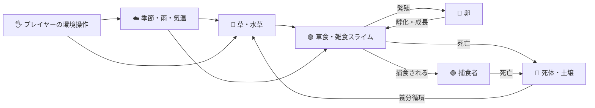

# Edenomaly — 予想外の進化を観察する人工生命ゲーム

> **Paradise Never Evolves as Planned.**  
> 楽園は、思いどおりには進化しない。

Edenomaly = **Eden（楽園）** + **Anomaly（想定外の現象）**。

プレイヤーがスライムを直接操作するのではなく、**地形・気候・資源を変えると、個体が何をし、何が生き残るのか**を観察するブラウザ向け人工生命シミュレーションです。進化や種の定着はあらかじめ決めた結末ではありません。

**現在の実装版：`2026.11.11.1`**（画面上部にも実行版を表示）

## ゲームでできること

| 🔭 観察する | 🌎 環境を変える | 🧬 発見する |
|---|---|---|
| 採食・交配・産卵・孵化・争い・捕食・休眠・死亡 | 草地・森・池・深水域・乾燥地・岩山・気温・雨・植物の再生 | 新種・希少な繁殖方式・しっぽ・角・触角・体表模様・変わった生存戦略 |
| 図鑑・イベント履歴・資源推移・繁殖診断 | 草や水草の補充・土壌改良・干ばつ・降雨 | **種族ごとの全数値能力の最小・中央値・最大をゲーム内で比較** |



*上図はゲームの関係性を示した概念図です。すべての生態的関係が常に成立するわけではありません。*

## すぐに始める（Windows / VSCode）

Python 3 がある場合、リポジトリのルートディレクトリで実行します。

```powershell
git pull
py -m http.server 8000 --directory web
```

ブラウザで **http://localhost:8000/** を開き、**「生命を移入」** を選んでフィールドをクリックしてください。

- **テストモード**：制限なく生態系を試す。地形や気候を変え、スライムの変化を観察。
- **ゲームモード**：最初の移入と介入ポイントに制約があり、生存時間・発見・生態系の状態をスコア化。
- **▶ 再生／Ⅱ 停止、1ステップ、速度×1／×3／×8**：時間を操作。
- **拡大・パン**：ホイールで拡大／縮小。中ボタンをドラッグ、または「✋ 移動」ONで左ドラッグ。
- **地形ブラシ**：草地・水辺・乾燥地・岩場と、**レベル1〜5**を選択して描く。初期マップにも中心ほど高レベルの地形が分布します。
- **資源と気候**：草と水草は独立した回復速度スライダー。四季・気温・降雨も操作可能です。

> 静的ファイルを配信するPythonはサーバーとしてのみ動きます。ゲーム本体は **HTML / CSS / JavaScript** です。 `web/index.html` を直接ダブルクリックするとES Modulesがブロックされる場合があります。

## 🧬 外見・遺伝・進化

スライムの体色は水・乾燥・岩場への適応値を合成して決まり、白色変異も稀に発生します。基本形は丸・楕円で、目の数や位置、食性、繁殖方式も遺伝します。

| 外見遺伝子（0〜1） | 目に見える特徴 | 生態的な利点と代償 |
|---|---|---|
| `tailLength` | **長く太い、動きに合わせて揺れるしっぽ** | 水中推進に有利。陸上移動と維持コストには不利 |
| `hornLength` | **背中に伸びる1〜2本の角** | 攻防に有利。移動・維持コストが増える |
| `antennaLength` | **体より外へ伸びる触角・明るい先端** | 探知距離が広がる。移動と維持コストには不利 |
| `pattern` | **見つけやすい斑点・縞模様** | 環境との適応度が高いと発見されにくい。維持コストあり |

**2026-11-11の描画改善**：今回のログではこれらの遺伝子値が低く、以前の線形描画ではほとんど見えませんでした。外観サイズのみ `表示強度 = 遺伝子値 ^ 0.43` の非線形変換で拡大し、輪郭とハイライトを強めています。**遺伝子値0では特徴を描画せず、生存能力・衝突判定・進化ルールも変更しません。**

<details>
<summary>表示例：遺伝子0.10のとき</summary>

| 項目 | 値 |
|---|---:|
| 遺伝子の実値 | 0.10 |
| 従来の線形表示強度 | 0.10 |
| 新しい表示強度（0.10^0.43） | 約0.37 |

*これは外観の強調倍率の比較であり、体長が3.7倍になるという意味ではありません。実寸は本体サイズに合わせて制限しています。*
</details>

### 🎨 描画モードをいつでも切り替え

画面の「描画」で、**ゼリー質感2D（初回の推奨）／高品質／クラシック**を切り替え可能です。ゼリー質感では膜の透明感・反射光・柔らかい輪郭を描画します。処理が重い場合は従来モードに戻せます。外見上の角・尾・触角・模様は各モードで表示されます。

## 🔎 種族図鑑と全ステータスの比較

「**種の図鑑 → 📊 種族ステータス一覧（全発見種）**」をクリックすると、ゲーム内に分析ウィンドウが開きます。

1. それまでに発生した**全種族（絶滅種を含む）**を検索・選択。
2. **出生時の全遺伝子・基礎能力**と、**現存する個体のHP・エネルギー等**を切り替え。
3. 各項目の**最小・中央値・最大**を範囲棒で表示し、種族間の違いを比較。
4. 閉じると再生状態に戻ります。**CSVファイルの保存や読み込みは不要**です。

種名は**カタカナ6文字**（体色2＋食性1＋生息環境1＋識別音2）。同じ分類の種には同じ名前が付きます。分類は大まかな表現型に基づき、**遺伝的な微差や外見装飾が違っても同一分類**になる場合があります。

## 🌱 生態系・ゲームバランス

- 草・水草・水量・土壌・死体の分解による養分循環が、地域ごとの収容力を変えます。池自体は干ばつでは消えません。
- 卵→幼体→成体へ成長し、交配・突然変異で遺伝子が継承されます。まれな雌雄同体・単為生殖も存在します。
- HPは生命力と残り寿命を兼ね、**食事で失ったHPは回復しません**。飢え・感染・暑さ寒さ・捕食が消耗を早めます。
- 森は食料が豊富でも移動・視野が悪化し、深水域・砂漠・高山も適応形質が重要になります。
- 目標は「放置での長期大量維持は難しいが、適切な環境介入で大規模な群集を作れる」こと。**生存数を特定の値に固定する人口調整はありません**。

### 最新ログで判明した課題

提供された試行（**Step 5100**）では、発見**213種**に対し現存**30種・82体**で、多くが小型の草食系に偏っていました。尾・角・触角・模様も遺伝値が低く、外見として識別しにくい傾向です。

- **実施済み**：外見特徴をより大きく描画。時系列ログが空でも現在状態を確認できるCSVを全ログZIPに追加。
- **今後の検証**：新種の「発見」と「定着」を別に扱う、食性・地形ごとの生存戦略を比較する、季節・繁殖阻害・死亡原因を時系列で確認する。
- **判断を保留**：草食・小型・乾燥適応に偏る原因を確定できていないため、生態バランスの係数を今回一斉に変更しません。

➡️ **[提供ログの分析結果と改善の優先順位](reports/species-log-2026-11-11.md)**

## 📦 ログの記録と分析

「**全ログをまとめて保存（ZIP）**」で、次の記録が出力されます。

| ファイル | 内容 |
|---|---|
| `edenomaly-ecology-*.csv` | 50ステップごとの生態系推移（記録済みの場合） |
| `edenomaly-current-ecology-*.csv` | **必ず現在の状態を1行記録**（時系列が空でも出力） |
| `edenomaly-individual-reproduction-*.csv` | 個体別繁殖診断 |
| `edenomaly-species-statistics-*.csv` | 全発見種の遺伝子・能力・現存状態の最小／中央値／最大 |

ログは同じ版のブラウザストレージに保存されます。**更新時は旧版のログが初期化される仕組み**のため、比較に使う記録は更新前にZIPとして保存してください。ゲーム内の種族分析はCSVなしでも利用できます。

## 🧪 開発・検証

Node.js 22以降で：

```powershell
npm test
npm run headless -- --seed 72 --steps 10000 --runs 4 --interval 50 --out results/headless
npm run name-audit -- --seed 72 --steps 1200 --runs 4
```

| ファイル | 役割 |
|---|---|
| `web/simulation.js` | 生態・遺伝・繁殖・環境のルール |
| `web/renderer.js`, `web/jelly-visuals.js` | 描画・ゼリー質感 |
| `web/slime-ornaments.js` | 角・尾・触角・模様の表示 |
| `web/species-statistics.js` | 出生個体の統計・中央値・CSV |
| `web/species-report.html`, `web/species-report-viewer.js` | ゲーム内・単独の種族能力比較ビュー |
| `web/ecology-log.js` | 長期生態・個体別記録 |
| `web/app.js`, `web/index.html`, `web/style.css` | UI・操作・画面 |
| `web/headless-cli.mjs` | 描画なしの再現性ある高速試行 |

**さらに詳しい実装履歴**： [旧READMEの詳細履歴](docs/IMPLEMENTATION_HISTORY.md) / [開発ロードマップ](ROADMAP.md) / [高速試験の説明](HEADLESS.md)

## 制約と今後の方向

- 「種族」は粗い表現型分類であり、生物学的な意味の完全な種分化ではありません。
- 記録した種族とゲームの実行状態は別です。**完全なセーブ／ロードは現時点では未実装**です。
- 一部のブラウザや大規模な群集では描画・ストレージ負荷が増えます。
- GitHubリポジトリは公開していますが、**現時点ではオープンソースライセンスを付与していません**。一般的な改変・再配布許諾を意味しません。

*イラスト等の画像ファイルは現時点でリポジトリに保存されていないため、過去チャットで生成した絵を存在しないパスで参照することはしていません。上記の図はGitHub上で表示できるMermaid概念図です。*
