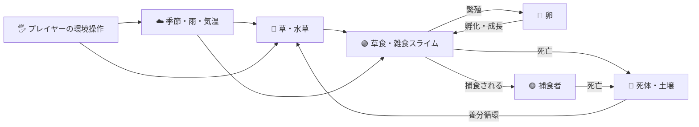

# Edenomaly — 予想外の進化を観察する人工生命ゲーム

> **Paradise Never Evolves as Planned.**  
> 楽園は、思いどおりには進化しない。

Edenomaly = **Eden（楽園）** + **Anomaly（想定外の現象）**。

プレイヤーがスライムを直接操作するのではなく、**地形・気候・資源を変えると、個体が何をし、何が生き残るのか**を観察するブラウザ向け人工生命シミュレーションです。進化や種の定着はあらかじめ決めた結末ではありません。

**現在の実装版：`2026.11.14.2`**（画面上部にも実行版を表示）

## ゲームでできること

| 🔭 観察する | 🌎 環境を変える | 🧬 発見する |
|---|---|---|
| 採食・交配・産卵・孵化・争い・捕食・休眠・死亡 | 草地・森・池・深水域・乾燥地・岩山・気温・雨・植物の再生 | 新種・希少な繁殖方式・しっぽ・角・触角・体表模様・変わった生存戦略 |
| 図鑑・イベント履歴・資源推移・繁殖診断 | 草や水草の補充・土壌改良・干ばつ・降雨 | **種族ごとの全数値能力の最小・中央値・最大をゲーム内で比較** |



*上図はゲームの関係性を示した概念図です。すべての生態的関係が常に成立するわけではありません。*

## すぐに始める（Windows / VSCode）

Python 3 がある場合、リポジトリのルートディレクトリで実行します。

```powershell
git pull
py -m http.server 8000 --directory web
```

ブラウザで **http://localhost:8000/** を開き、**「生命を移入」** を選んでフィールドをクリックしてください。

- **テストモード**：制限なく生態系を試す。地形や気候を変え、スライムの変化を観察。
- **ゲームモード**：最初の移入と介入ポイントに制約があり、生存時間・発見・生態系の状態をスコア化。**3世代・12体を達成した種族の定着ボーナス**も獲得できます。
- **▶ 再生／Ⅱ 停止、1ステップ、速度×1／×3／×8**：時間を操作。
- **拡大・パン**：ホイールで拡大／縮小。中ボタンをドラッグ、または「✋ 移動」ONで左ドラッグ。
- **地形ブラシ**：草地・水辺・乾燥地・岩場と、**レベル1〜5**を選択して描く。初期マップにも中心ほど高レベルの地形が分布します。
- **資源と気候**：草と水草は独立した回復速度スライダー。四季・気温・降雨も操作可能です。

> 静的ファイルを配信するPythonはサーバーとしてのみ動きます。ゲーム本体は **HTML / CSS / JavaScript** です。 `web/index.html` を直接ダブルクリックするとES Modulesがブロックされる場合があります。

## 🎮 ゲームモード：観察・発見・介入・再挑戦（2026-11-14）

プレイモードで「🎮 ゲームモード」を選択すると、**ゲーム開始の案内**が表示されます。開始地点をフィールドでクリックすると、最初の1種・8体を移入し、**自動的に2.8倍へ拡大**して観察を始めます。

- **📍 視野固定**：当初の群れが離れていっても、カメラは残ります。見逃した地域でも進化は進みます。
- **🎯 群れを追尾**：ボタンを押すと、最初の群れ（絶滅後は残った近隣の子孫側）へ自動的にカメラを移動します。自分でズーム・パンすると追尾を解除できます。
- **群れへ戻る**：一度他の場所を観察した後、元の群れの近くへ戻ります。
- **視野内／視野外の個体数**：実際のズームとパン範囲で集計。視野内のエネルギー不足個体数も表示。
- **🔔 観察・発見イベント**：新種の発見・定着・視野外への拡散・栄養不足・介入ポイント獲得を、通常の大量イベントログとは別に表示。通知に位置情報がある場合「現地を見る」で移動可能。
- **遠方の生命反応**は初めは解放されていません。恒久報酬で解放すると、視野外の新種が発生した方角と調査位置を知らせます。未訪問の新種名は通知文で明かしません。
- **ゲームオーバー**：全個体と全卵の消失で自動停止。スコア・発見種・定着種・主な死亡原因・恒久報酬を表示。「次の世界へ」で再挑戦できます。

### 報酬を獲得・利用する

ゲーム中の行動で得る**介入ポイント**と、ゲーム終了時に蓄積する**恒久報酬ポイント**は別です。

| 解放内容 | 恒久報酬コスト | 効果 |
|---|---:|---|
| 🔭 遠方の生命反応 | 3pt | 離れた場所での新種・定着の兆候を重要イベントに追加 |
| 🌱 初期支援ポイント＋5 | 4pt | 次の試行の初期介入ポイントを15→20へ増量 |

恒久報酬はスコア1,000点ごとに1pt（切り捨て）獲得します。ゲーム開始の案内、またはゲームモードの報酬欄から解放できます。**どちらも1回購入するとブラウザに保存**され、次の試行から利用可能です。課金はありません。終了時の恒久報酬は同じ試行で二重に取得できないようにしています。

スライムの遺伝子や生態系の進化を直接操作する強化ではなく、まずは観察能力と介入の選択肢を増やす仕組みです。

**実験とテスト**：ゲームUIのイベント検出・視野計算・報酬解放・一度きりの報酬付与を `web/game-experience.test.mjs` で検証しています。ブラウザでの実際の操作感・FPSの目視確認は引き続き必要です。

## 🩺 感染症と防疫のゲームプレイ（2026-11-14）

**感染症は、同系統の個体の密集・接触で発生・拡大し、遺伝子 `resist` によってかかりにくさやHP減少が変わります。** 感染すると時間とともにHPが減り、繁殖が阻害されます。自然に感染期間が終われば回復しますが、失ったHPは回復しません。感染による死亡判定には、死亡時に他の直接原因がなく感染中であった個体も含まれるため、「感染症」だけが唯一の死因だったとは断定できません。

- 画面に感染個体数を表示し、視野内で感染を確認すると**重要イベントで警告**します。
- **ゲームモード限定の「🩺 防疫・隔離（9pt）」**を選び、感染した群れをクリックすると、その中心から**65ワールド座標以内**の感染期間を**45ステップ短縮**し、周辺の個体は**110ステップ再感染のリスクを抑えます**。
- 防疫はHPを回復させず、卵や死者を復活させず、遺伝子も変えません。感染中の個体が近くにいない地点では使用できません。
- 密集は栄養競争や感染を招くため、**栄養補充で延命しつつ、密集した群れには早めに防疫を行う**のが基本戦略です。広がった群れの全地域を助けるにはポイント配分が必要です。
- 自然発生と接触感染の確率も小幅に調整しました。十分な多シード評価を続け、感染が単純なゲームオーバー原因になりすぎないか検証します。

## 📦 ゲームモードの自動ログ

ゲームを始めると、**50ステップごとに**生態系CSV用の時系列・繁殖診断・種族ステータスがブラウザのストレージへ記録されます。**ゲームオーバー時は最後のステップを必ず記録し、分析用ZIPを自動的にダウンロード**する処理を開始します。ZIP内には、時系列・個体診断・種族能力・イベントCSVに加え、**得点・死因・感染数・回復数・プレイヤーの介入履歴を含む `edenomaly-game-report.json`** を入れます。

- ブラウザのダウンロード設定によっては自動保存がブロックされます。**ゲームオーバー画面の「分析用ログZIPを保存」ボタン**で手動保存してください。
- 直近12試行の簡約レポートもブラウザ内に保存します（`edenomaly:game-run-history:v1`）。生態系・種族の記録は**バージョンを更新しても引き継ぐ**ようにしました。容量不足やプライベートモードでは保存できない場合があるので、**ZIPをPCに保存することが最も確実**です。
- **ChatGPTへ分析を依頼するにはダウンロードしたZIPをこのチャットへ添付**してください。ChatGPTがブラウザのローカルストレージを自動で読み取るわけではありません。
- 実行中の生命の状態を再開するセーブデータではなく、**結果分析用の記録**です。

## 🧬 外見・遺伝・進化

スライムの体色は水・乾燥・岩場への適応値を合成して決まり、白色変異も稀に発生します。基本形は丸・楕円で、目の数や位置、食性、繁殖方式も遺伝します。

| 外見遺伝子（0〜1） | 目に見える特徴 | 生態的な利点と代償 |
|---|---|---|
| `tailLength` | **1〜3個の丸いゼリー玉が連なるしっぽ** | 水中推進に有利。陸上移動と維持コストには不利 |
| `hornLength` | **頭の左右に必ず対称に付く2個の丸いコブ（強く発達するとそれぞれ2連）** | 攻防に有利。移動・維持コストが増える |
| `antennaLength` | **頭の前半分だけに付いた短い丸玉の触角** | 探知距離が広がる。移動と維持コストには不利 |
| `pattern` | **柔らかい丸い斑点・ほっぺ模様** | 環境との適応度が高いと発見されにくい。維持コストあり |

**2026-11-11の描画改善**：今回のログではこれらの遺伝子値が低く、以前の線形描画ではほとんど見えませんでした。外観サイズのみ `表示強度 = 遺伝子値 ^ 0.43` の非線形変換で拡大し、輪郭とハイライトを強めています。**遺伝子値0では特徴を描画せず、生存能力・衝突判定・進化ルールも変更しません。**

<details>
<summary>表示例：遺伝子0.10のとき</summary>

| 項目 | 値 |
|---|---:|
| 遺伝子の実値 | 0.10 |
| 従来の線形表示強度 | 0.10 |
| 新しい表示強度（0.10^0.43） | 約0.37 |

*これは外観の強調倍率の比較であり、体長が3.7倍になるという意味ではありません。実寸は本体サイズに合わせて制限しています。*
</details>

**2026-11-11 のかわいい外見調整**：しっぽ・角・触角を、鋭い三角形や細い線ではなく、**重なり合う半透明の円・楕円（ゼリー玉）**だけで描くよう変更しました。角と触角は顔の上側・下側へ同じ大きさのペアで配置し、手前の描画レイヤーに置くことで片側だけが隠れないようにしています。尾は後端中央から伸びます。斑点も淡い丸形に統一。体色や形態遺伝子が決める機能・維持エネルギーは以前と同じです。

### 🎨 描画モードをいつでも切り替え

画面の「描画」で、**ゼリー質感2D（初回の推奨）／高品質／クラシック**を切り替え可能です。ゼリー質感では膜の透明感・反射光・柔らかい輪郭を描画します。処理が重い場合は従来モードに戻せます。外見上の角・尾・触角・模様は各モードで表示されます。

## 🔎 種族図鑑と全ステータスの比較

「**種の図鑑 → 📊 種族ステータス一覧（全発見種）**」をクリックすると、ゲーム内に分析ウィンドウが開きます。

1. それまでに発生した**全種族（絶滅種を含む）**を検索・選択。
2. **出生時の全遺伝子・基礎能力**と、**現存する個体のHP・エネルギー等**を切り替え。
3. 各項目の**最小・中央値・最大**を範囲棒で表示し、種族間の違いを比較。
4. 閉じると再生状態に戻ります。**CSVファイルの保存や読み込みは不要**です。

種名は**「見た目の色名＋生態ステータス由来のコード名＋特徴」**です。例：`パープルソイムカキテール` のように紫系統の水／岩場等を示すコードと尾の特徴が付きます。色相が赤と紫の境界に近い希少な個体では`レッドパープル…ホーンテール`のような複合色・特徴名にもなります。

- **色**：実際に表示される体色の色相から「レッド／イエロー／グリーン／ブルー／パープル／ピンク／ホワイト」を選びます。境界付近はまれに2色をつなぎます。
- **コード**：食性1文字＋生息環境1文字＋大まかな色分類1文字＋体格・体型・目・繁殖・行動・温度の組み合わせ2文字。約11万分類に対して重複しない5文字の識別コードです。
- **特徴**：最も強い形態遺伝子（角・尾・触角・模様）から`ホーン／テール／アンテナ／スポット`を付けます。上位2形質が近い場合は`ホーンテール`など複合語尾になり、目立つ特徴がなければ**語尾を付けず、色名＋コードだけ**で終わります。
- **分類と名前の一致**：色名と優勢な外見特徴も分類キーに含めます。同じ生態でも角優勢と尾優勢は別種、特徴なしも別種です。微小な遺伝値差は同一区分なら同種。分類名は初発見時に固定し、図鑑・ログ・定着実績で同じキーを使います。

## 🏆 新種の定着実績（2026-11-11）

新種が1個体現れただけで「定着した」とは見なしません。図鑑とゲームスコアに、次の進捗を追加しました。

- **🌱 3世代継続**：最初に分類された個体の世代から2世代進み、計3世代を確認した種。ゲームモードでは介入ポイント+5。
- **🐣 12体到達**：同じ種が同時に12体以上生存した実績。介入ポイント+5。
- **🏆 定着成功**：上記2条件を両方達成。種名の横に記録し、ゲームスコア **+450点**、ゲームモードで介入ポイント **+15**。どの報酬も種ごとに一度限りです。
- 達成後に絶滅しても定着実績は残ります。条件を満たさない新種にも発見ボーナスは引き続き付きます。

## 🧪 多シード比較による調整

同一のシードを6地点（通常の草地・岸辺の草地・深い池・池の縁・乾燥地・岩場）へ適用し、**16シード×6地点×介入あり／なし＝192試行（各1200ステップ）**を複数回実行する方法で調整しています。

- **岩場**：地衣類（菌類を含む岩場の植生）の再生・上限を調整。従来からの岩場適応遺伝子 `rock` が地衣類の採食効率・水分保持・移動に役立つようにしました。
- **岸辺**：`wet` の高い陸生種が**岸から浅い水域の水草を少量採食**できます。水中に入れるようにはせず、既存の水草を実際に消費します。
- **岩場介入**：ゲームモードの「種をまく」で岩場の地衣類を補充可能。雨を降らせると岩の割れ目に水分を保持し、地衣類再生を助けます。
- **食性と維持費**：雑食種の植物栄養吸収を少し改善し、肉食・腐肉食の栄養量を小幅に調整。岩場の移動・維持コストを軽減しました。
- **遺伝子の棚卸し**：既存の `wet`・`rock` を活用したため新しい遺伝子は増やさず、使用中の遺伝子も一括削除していません。初期化時の到達不能な分岐を削除し、派生遺伝子の管理を一元化しました。

**最新の192試行での確認**：岩場の資源介入ありでは16試行中の生存が2→8試行に改善しましたが、岩場の無介入は6→3試行へ悪化しました。**まだ全地形で生存率が均等になったわけではありません。** 個体群への環境介入と自然維持の両立が次の課題です。

詳細：[192試行の前後比較と悪化点](reports/location-balance-2026-11-11.md) ／ [遺伝子の棚卸し](reports/gene-audit-2026-11-11.md) ／ [地点比較の実験コード](web/location-experiment.mjs) ／ [ゲーム品質の分析](reports/species-log-2026-11-11.md)

## 🌱 生態系・ゲームバランス

- 草・水草・水量・土壌・死体の分解による養分循環が、地域ごとの収容力を変えます。池自体は干ばつでは消えません。
- 卵→幼体→成体へ成長し、交配・突然変異で遺伝子が継承されます。まれな雌雄同体・単為生殖も存在します。
- HPは生命力と残り寿命を兼ね、**食事で失ったHPは回復しません**。飢え・感染・暑さ寒さ・捕食が消耗を早めます。
- 森は食料が豊富でも移動・視野が悪化し、深水域・砂漠・高山も適応形質が重要になります。
- 目標は「放置での長期大量維持は難しいが、適切な環境介入で大規模な群集を作れる」こと。**生存数を特定の値に固定する人口調整はありません**。

### 最新ログで判明した課題

提供された試行（**Step 5100**）では、発見**213種**に対し現存**30種・82体**で、多くが小型の草食系に偏っていました。尾・角・触角・模様も遺伝値が低く、外見として識別しにくい傾向です。

- **実施済み**：外見特徴をより大きく描画。時系列ログが空でも現在状態を確認できるCSVを全ログZIPに追加。
- **今後の検証**：新種の「発見」と「定着」を別に扱う、食性・地形ごとの生存戦略を比較する、季節・繁殖阻害・死亡原因を時系列で確認する。
- **判断を保留**：草食・小型・乾燥適応に偏る原因を確定できていないため、生態バランスの係数を今回一斉に変更しません。

➡️ **[提供ログの分析結果と改善の優先順位](reports/species-log-2026-11-11.md)**

## 📦 ログの記録と分析

「**全ログをまとめて保存（ZIP）**」で、次の記録が出力されます。

| ファイル | 内容 |
|---|---|
| `edenomaly-ecology-*.csv` | 50ステップごとの生態系推移（記録済みの場合） |
| `edenomaly-current-ecology-*.csv` | **必ず現在の状態を1行記録**（時系列が空でも出力） |
| `edenomaly-individual-reproduction-*.csv` | 個体別繁殖診断 |
| `edenomaly-species-statistics-*.csv` | 全発見種の遺伝子・能力・現存状態の最小／中央値／最大 |

ログは同じ版のブラウザストレージに保存されます。**更新時は旧版のログが初期化される仕組み**のため、比較に使う記録は更新前にZIPとして保存してください。ゲーム内の種族分析はCSVなしでも利用できます。

## 🧪 開発・検証

Node.js 22以降で：

```powershell
npm test
npm run headless -- --seed 72 --steps 10000 --runs 4 --interval 50 --out results/headless
npm run name-audit -- --seed 72 --steps 1200 --runs 4
```

| ファイル | 役割 |
|---|---|
| `web/simulation.js` | 生態・遺伝・繁殖・環境のルール |
| `web/renderer.js`, `web/jelly-visuals.js` | 描画・ゼリー質感 |
| `web/slime-ornaments.js` | 角・尾・触角・模様の表示 |
| `web/species-statistics.js` | 出生個体の統計・中央値・CSV |
| `web/species-report.html`, `web/species-report-viewer.js` | ゲーム内・単独の種族能力比較ビュー |
| `web/ecology-log.js` | 長期生態・個体別記録 |
| `web/app.js`, `web/index.html`, `web/style.css` | UI・操作・画面 |
| `web/headless-cli.mjs` | 描画なしの再現性ある高速試行 |

**さらに詳しい実装履歴**： [旧READMEの詳細履歴](docs/IMPLEMENTATION_HISTORY.md) / [開発ロードマップ](ROADMAP.md) / [高速試験の説明](HEADLESS.md)

## 制約と今後の方向

- 「種族」は粗い表現型分類であり、生物学的な意味の完全な種分化ではありません。
- 記録した種族とゲームの実行状態は別です。**完全なセーブ／ロードは現時点では未実装**です。
- 一部のブラウザや大規模な群集では描画・ストレージ負荷が増えます。
- GitHubリポジトリは公開していますが、**現時点ではオープンソースライセンスを付与していません**。一般的な改変・再配布許諾を意味しません。

*イラスト等の画像ファイルは現時点でリポジトリに保存されていないため、過去チャットで生成した絵を存在しないパスで参照することはしていません。上記の図はGitHub上で表示できるMermaid概念図です。*
